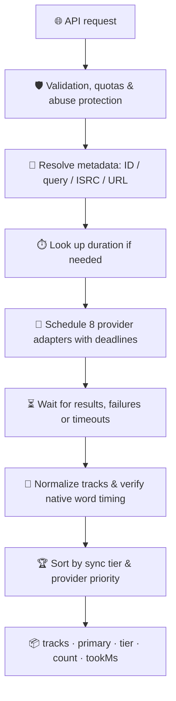

<a id="top"></a>

<div align="center">


<h1>🎧 LiriQo Lyrics API</h1>

<p><strong>One API. Eight lyric providers. Native karaoke timing.</strong></p>
<p>Get <strong>syllable</strong>, <strong>word</strong>, <strong>line</strong>, or <strong>plain</strong> lyrics in a normalized format — with accurate timing and upstream attribution when available.</p>

<p>
  <a href="https://api-liriqo.web.app/"></a>
  <a href="https://api.liriqo-alfarrizi.my.id/v1"></a>
  <a href="#providers"></a>
  <a href="lyrics-parser/README.md"></a>
</p>
<p>
  <a href="https://github.com/AlFarrizi-Studio/LiriQo/releases"></a>
  <a href="https://github.com/AlFarrizi-Studio/LiriQo/stargazers"></a>
  <a href="https://github.com/AlFarrizi-Studio/LiriQo/issues"></a>
</p>

<p><strong>
  <a href="#quick-start">🚀 Quick Start</a> ·
  <a href="#providers">🎼 Providers</a> ·
  <a href="#api-reference">📡 API Reference</a> ·
  <a href="#lyrics-parser">🧩 Parser</a> ·
  <a href="#star-history">⭐ Star History</a>
</strong></p>

</div>

---

## ✨ Overview

LiriQo resolves song metadata, requests available lyrics from multiple providers, and returns **normalized timing with provider attribution**. Public client endpoints do not require an API key, but requests remain subject to quotas, capacity limits, and abuse protection.

| 🎤 Karaoke-ready | 🧭 Smart fallback | 🔌 Flexible inputs | 🛡️ Server protection |
| :--- | :--- | :--- | :--- |
| Native TTML, richsync, YRC, KRC and QRC timing | Prioritizes native word/syllable → line → plain tracks | Video IDs, titles, artists, ISRCs and supported URLs | Quotas, caching, bounded provider requests and WAF/ban controls |

- 🎤 **Native karaoke timing:** Apple Music TTML, Musixmatch richsync, NetEase YRC, KuGou KRC and QQ Music QRC.

- 🏆 **Quality-aware selection:** word/syllable timing first, then line timing, then plain text, with a separate provider order for each tier.

- 🔎 **Multiple inputs:** YouTube video ID, title and artist, search query, ISRC, or supported YouTube/Spotify URLs.

- 🧩 **Client parser:** preserves native word boundaries, singer agents, background vocals and attribution when supplied.

- 🛡️ **Operational controls:** bounded provider work, timeouts, request coalescing, caching, WAF/ban handling and public IP masking.

> [!NOTE]
> **Implementation scope:** this README describes the current Node/Termux server in [`termux-server/server.mjs`](termux-server/server.mjs) and the client parser in [`lyrics-parser/`](lyrics-parser/README.md). The public API reported version `1.5.1` when checked on November 2, 2026. The root `src/` + `wrangler.toml` contain an older Cloudflare Worker implementation; its provider set, ranking and behavior are not identical.

## 🧭 Table of contents

| Get started | Reference & internals |
| :--- | :--- |
| [🚀 Quick start](#quick-start) | [📦 Response format](#response-format) |
| [🎼 Providers](#providers) | [🧩 Lyrics parser](#lyrics-parser) |
| [🏆 Sync tiers & priority](#sync-tiers-and-provider-priority) | [🔄 Resolution pipeline](#resolution-pipeline) |
| [📡 API reference](#api-reference) | [🛡️ Caching, security & statistics](#caching-security-and-statistics) |
| [🎶 Lyrics inputs](#lyrics-inputs) | [🗂️ Repository & validation](#repository-and-validation) |
| [🚨 Errors & retries](#errors-and-retries) | [🙌 Credits](#credits) · [📄 License](#license) · [⭐ Star History](#star-history) |

## 🚀 Quick start

**🌐 Public API base URL:** [`https://api.liriqo-alfarrizi.my.id/v1`](https://api.liriqo-alfarrizi.my.id/v1)

> [!TIP]
> Public client endpoints do not require an API key. Respect rate limits and honor `Retry-After` when returned.

### 💻 cURL

Fetch normalized lyrics and all returned provider candidates:

```sh
curl "https://api.liriqo-alfarrizi.my.id/v1/lyrics?v=HaEYUJ2aRHs"
```

Search by title and artist, or pass explicit metadata:

```sh
curl --get "https://api.liriqo-alfarrizi.my.id/v1/lyrics" --data-urlencode "Q=Dynamite BTS"
curl --get "https://api.liriqo-alfarrizi.my.id/v1/lyrics" --data-urlencode "title=Dynamite" --data-urlencode "artist=BTS" --data-urlencode "duration=199"
```

Request a specific output format using a video ID:

```sh
curl "https://api.liriqo-alfarrizi.my.id/v1/lrc?v=HaEYUJ2aRHs"
curl "https://api.liriqo-alfarrizi.my.id/v1/plain?v=HaEYUJ2aRHs"
curl "https://api.liriqo-alfarrizi.my.id/v1/ttml?v=HaEYUJ2aRHs"
```

### 🟨 JavaScript

```js
const url = new URL('https://api.liriqo-alfarrizi.my.id/v1/lyrics');
url.searchParams.set('v', 'HaEYUJ2aRHs');

const response = await fetch(url, { signal: AbortSignal.timeout(30000) });
if (!response.ok) throw new Error(`LiriQo HTTP ${response.status}`);

const data = await response.json();
if (data.error) throw new Error(data.error);

const primary = data.primary;
for (const line of primary?.timed ?? []) {
  console.log(line.start, line.end, line.text);
  const words = line.words ?? primary.words?.[line.id] ?? [];
  for (const word of words) {
    console.log(word.start, word.end, word.text);
  }
}
```

Use embedded `timed[].words` first, with top-level `words[line.id]` as a compatibility fallback. A missing word array means that line must be rendered without word-level highlighting.

## 🎼 Providers

The current server schedules **8 provider adapters**. LyricFind can appear as the source behind YouTube Music; it is not a ninth direct adapter.

| Provider | API provider ID | Supported timing | Format and notes |
| --- | --- | --- | --- |
| 🍎 **Apple Music** | `apple_music_liriqo` | `syllable`, `word`, `line`, `plain` | Apple Music TTML retrieved through lrc.red, plus normalized timing; singer agents and background vocals when present. ISRC/name-based lookup. |
| 🎤 **Musixmatch** | `musixmatch` | **`word`** | Direct native richsync. The adapter is separate from Musixmatch lyrics obtained through YouTube Music. Only native richsync results are accepted. |
| 🤝 **Unison** | `unison_community` | `syllable`, `line`, `plain`, depending on the submission | Community TTML/LRC/plain lyrics. Word/syllable units inside TTML are emitted under `syllable` when normalized words exist. |
| ☁️ **NetEase Cloud Music** | `netease` | **`word`**, `line`, `plain` | Native **YRC** word timing first; LRC/plain fallback. Translation when supplied. `nativeWordTiming` identifies native word output. |
| 🎶 **KuGou** | `kugou_legato` | **`word`**, `line` | KRC decoded server-side into native per-word timing; decoded `krc` may also be returned. |
| 🎧 **QQ Music** | `qq_portato` | **`word`**, `line` | QRC decrypted server-side; translations and romanization when available. |
| 📚 **LRCLib** | `lrclib` | **`line`, `plain` only** | Synced LRC or unsynced text. The current service does **not** generate proportional word timing. |
| ▶️ **YouTube Music** | `ytm_line` | `line`, `plain` | InnerTube timed/plain lyrics; `lyricsSource` and `upstreamProvider` preserve Musixmatch/LyricFind attribution when known. |

> [!IMPORTANT]
> **Provider support ≠ availability for every song.** A provider can have native word support while returning only line timing for a particular song. For example, NetEase falls back to LRC when usable YRC is absent. Providers that fail, time out or have no matching lyrics do not contribute a track.

The current YTM wrapper can label plain text stored in zero-timestamp entries as `line`. Validate that line windows have `end > start` before enabling synchronized playback; the parser rejects invalid timing and can still use the text as a plain fallback.

Client API-key-free access does not imply credential-free upstreams. Provider availability depends on the server's upstream configuration and sessions, particularly for direct Musixmatch and some metadata lookups.

## 🏆 Sync tiers and provider priority

| Tier | `syncLevel` | Meaning |
| --- | --- | --- |
| 🥇 **Jagorawi** | `syllable` or `word` | Native karaoke timing |
| 🥈 **Cipali** | `line` | Timestamped lyric lines |
| 🥉 **Bocimi** | `plain` | Text without playback timing |

Word and syllable tracks share the **same quality tier**. The current service does not automatically rank every syllable track above every word track; provider priority breaks ties within Jagorawi.

**🥇 Native word/syllable priority:**

```text
Apple Music → Musixmatch → Unison → NetEase → KuGou → QQ Music
```

**🥈 Line / 🥉 plain priority:**

```text
Apple Music → LRCLib → Unison → NetEase → KuGou → QQ Music → YouTube Music
```

`tracks` is sorted by tier, then the applicable provider order. `primary` is the first returned track. A word track from NetEase therefore outranks a line-only Apple Music track.

The `/plain` endpoint uses the text-provider order regardless of the track's original sync tier. `/ttml` chooses an existing TTML payload; it does not fabricate TTML from word arrays. `/lrc` serializes selected normalized lines, so use `/lyrics` for native karaoke word data.

## 📡 API reference

All paths below are relative to the API base. Normal client access is `GET`; CORS preflight handling is separate.

| Endpoint | Output | Input / behavior |
| --- | --- | --- |
| `/lyrics` | JSON | Resolve metadata and return ranked provider tracks. See [lyrics inputs](#lyrics-inputs). |
| `/lrc` | `text/plain` | Line-synced LRC export; requires `v` or `videoId`. |
| `/plain` | JSON | `{ videoId, provider, syncLevel, tier, lyrics }`; requires `v` or `videoId`. |
| `/ttml` | Raw TTML text | Requires `v` or `videoId`; returns `404` if no real TTML is available. The current Node server sends `text/plain`. |
| `/search` | JSON | Metadata resolution without lyrics; use `v`, `Q`/`q`/`query`, or `isrc`. An ISRC result may have `videoId: null`. |
| `/metadata`, `/resolve` | JSON | Aliases of `/search` in the current Node server. |
| `/stats` | JSON | Request metrics, selected-provider summaries, masked public IP lists and ban feed. |
| `/health` | JSON | Status, version and uptime. `upstream=1` requires administrator access. |
| `/` | JSON or HTML | Endpoint documentation, depending on the requested content type. |

### 🎶 Lyrics inputs

These parameters apply to **`/lyrics`**, not uniformly to every endpoint.

| Parameter | Example | Purpose |
| --- | --- | --- |
| `v` / `videoId` | `HaEYUJ2aRHs` | YouTube video ID; metadata is inferred when missing. |
| `Q` / `q` / `query` | `Dynamite BTS` | Search for the song and resolve metadata. |
| `title` + `artist` | `Dynamite` + `BTS` | Explicit song metadata. |
| `duration` | `199` | Song duration in **seconds**; helps matching. |
| `album` | `BE` | Optional matching metadata. |
| `isrc` | `QM7282022872` | Resolve recording metadata and assist provider matching. |
| `url` / `link` | A YouTube or Spotify track URL | URL resolution supported by the current server; Spotify metadata can depend on server configuration. |

```sh
curl --get "https://api.liriqo-alfarrizi.my.id/v1/lyrics" --data-urlencode "isrc=QM7282022872"
curl --get "https://api.liriqo-alfarrizi.my.id/v1/lyrics" --data-urlencode "url=https://open.spotify.com/track/3a1lNhkSLSkpJE4MSHpDu9"
curl --get "https://api.liriqo-alfarrizi.my.id/v1/search" --data-urlencode "Q=Dynamite BTS"
```

Do not assume arbitrary music URLs, Apple Music links, Tidal, song.link or generic web pages are supported by this runtime. `/search` also does not currently implement the same URL-resolution path as `/lyrics`; use its query/video/ISRC inputs. For title-and-artist search, put both in `Q` rather than relying on separate `/search` fields.

### ⚙️ Modes and diagnostics

- `full=1` and `fast=1` are accepted compatibility parameters. The current Node lyrics service waits for all scheduled provider tasks to settle under their timeouts/deadlines in either mode. They do **not** enable tier-progressive early completion in this implementation.

- `debug=1` exposes `_dbg` only to privileged administrators. Public responses strip it.

- `health?upstream=1` is privileged; a public health check does not probe every provider.

- A successful lookup can return fewer than eight tracks. `count` is the number actually returned, not the configured provider count.

### 🚨 Errors and retries

> [!IMPORTANT]
> Check both HTTP status and the JSON `error` field. Some resolution failures are returned as JSON error envelopes even when the route responds with HTTP `200`.

| Status / result | Client handling |
| --- | --- |
| `400` | Fix missing or invalid input. Format endpoints require a video ID. |
| `403` | Access denied, banned request or privileged operation. |
| `404` | Requested output format is unavailable, or the route does not exist. |
| `429` | Rate-limited; honor `Retry-After` when present. |
| `503` | Capacity or temporary service failure; back off and honor `Retry-After` when present. |
| `tracks: []`, `primary: null`, `count: 0` | No usable provider result for this lookup; not equivalent to a throttled request. |

> [!WARNING]
> Avoid retry loops and parallel duplicate lookups. The client parser exposes `ApiError.status`, `ApiError.code` and `ApiError.retryAfter`; retries remain the caller's responsibility.

## 📦 Response format

The `/lyrics` endpoint returns a ranked provider list and a selected `primary` track.

> [!NOTE]
> The JSON below is **illustrative**. It does not promise that this text or provider will be returned for every lookup.

```json
{
  "videoId": "HaEYUJ2aRHs",
  "metadata": {
    "title": "Dynamite",
    "artist": "BTS",
    "duration": 199,
    "isrc": "QM7282022872"
  },
  "count": 1,
  "tookMs": 1200,
  "tier": "Jagorawi",
  "primary": {
    "provider": "netease",
    "syncLevel": "word",
    "tier": "Jagorawi"
  },
  "tracks": [
    {
      "provider": "netease",
      "upstreamProvider": "NetEase Cloud Music",
      "syncLevel": "word",
      "tier": "Jagorawi",
      "nativeWordTiming": true,
      "plain": "Hello world",
      "timed": [
        {
          "id": 0,
          "text": "Hello world",
          "start": 1000,
          "end": 3000,
          "words": [
            { "text": "Hello ", "start": 1000, "end": 1800 },
            { "text": "world", "start": 1900, "end": 3000 }
          ]
        }
      ]
    }
  ]
}
```

The example abbreviates `primary`; actual responses include the full selected track there. Additional envelope fields such as `isVideoId`, `matchScore` and metadata cache markers may be present. `tookMs` measures lyrics-service work, not the complete client round trip.

### ⏱️ Timing units

| Value | Unit |
| --- | --- |
| Request `duration`, numeric metadata duration | **Seconds**; some search metadata can contain an `mm:ss` string |
| `timed[].start` / `end` | **Absolute milliseconds** |
| Word `start` / `end` | **Absolute milliseconds** |
| Parsed `startTimeMs` / `durationMs` | **Milliseconds** |
| Raw Musixmatch richsync `ts`, `te`, word offset `o` | Seconds; `o` is relative to its line start |
| Raw NetEase YRC line/word timestamps | Milliseconds; word timestamps are absolute |

Keep native word ends and gaps intact. Do not multiply normalized timestamps by 1000, redistribute words evenly, or assume every line ends exactly when the next begins. Some line-only LRC routes use estimated line ends; those are not native word windows.

### 🧬 Track fields

| Field | Meaning |
| --- | --- |
| `provider` | LiriQo adapter ID from the provider table. |
| `upstreamProvider`, `lyricsSource` | Actual upstream attribution when supplied; especially important for YouTube Music. |
| `syncLevel`, `tier` | Timing granularity and quality tier. |
| `plain` | Plain lyric text. |
| `timed[]` | Lines with `text`, `id`, `start`, `end` and optional embedded `words`. |
| `words[]` | Optional top-level per-line word arrays, addressed by line ID. |
| `agent`, `songPart`, `isCue`, `isInstrumental` | Optional normalized line annotations; not guaranteed for every provider. Background information retained in raw TTML becomes `parts[].isBackground` in the client parser. |
| `ttml`, `lrc`, `qrc`, `krc` | Optional raw, decoded or generated representations. QRC/KRC decoding is performed server-side; LRC may be generated from normalized lines. |
| `nativeWordTiming`, `nativeRichsync` | Provider-specific evidence of native timing. |
| `translation`, `romanization` | Optional supplementary text; availability and alignment vary. |

Raw `yrc`/`richsync` are accepted by the client parser when provided, but the server may expose their content only as normalized `timed[].words`. Do not require raw fields for karaoke playback.

## 🧩 Lyrics parser

The [client parser documentation](lyrics-parser/README.md) covers the complete API. It supports all eight adapter IDs and can also parse an already-fetched response offline.

```js
import { getLiriQoLyrics, ApiError } from './lyrics-parser/src/index.js';

try {
  const result = await getLiriQoLyrics('HaEYUJ2aRHs', {
    duration: 199,
    song: 'Dynamite',
    artist: 'BTS',
    timeout: 30000,
  });
  const selected = result.richsynced ?? result.synced ?? result.plain;
  for (const line of selected?.lyrics ?? []) {
    if (line.isInstrumental) continue;
    console.log(selected.source, line.startTimeMs, line.words);
    for (const part of line.parts ?? []) {
      console.log(part.startTimeMs, part.durationMs, part.words, part.isBackground);
    }
  }
} catch (error) {
  if (error instanceof ApiError) {
    console.error(error.code, error.status, error.retryAfter);
  } else {
    throw error;
  }
}
```

| Result | Content |
| --- | --- |
| `richsynced` | Native word/syllable `parts[]`, or `null`. |
| `synced` | Line-synced lyrics without word parts, or `null`. |
| `plain` | Unsynced text, or `null`. |
| `provider`, `syncedProvider`, `plainProvider` | Selected adapter for each result slot. |
| `route` | Parsed representation: `ttml`, `qrc`, `yrc`, `richsync`, `words`, `timed`, `lrc` or `plain`. |

The parser tries usable TTML, decrypted QRC, YRC/richsync, normalized timing and LRC representations, with fallback inside the same track if a raw representation fails. It verifies actual word parts rather than trusting a tier label and applies duration-fit checks to timed candidates.

Pass numeric seconds to the parser's `duration` option when search metadata contains a formatted duration string. Native timing is preserved; the main parser no longer rebuilds KuGou/NetEase words through proportional LRC distribution. Legacy `lrclib_wordsync` tracks are ignored. TTML background vocals, singer agents and songwriters are retained where available. Instrumental gap markers use a configurable threshold, normally 5000 ms. Text translations attach only when line counts match; romanization is not automatically aligned.

**Requirements:** Node.js 20.3+ or a compatible browser bundler. This is a private local package, not an npm-published zero-dependency SDK. It uses locally vendored parser dependencies; retain the required `lyrics-parser/node_modules` content when copying it. See the parser README for dependency and license caveats.

## 🔄 Resolution pipeline



**Adapters:** Apple Music · Musixmatch · Unison · NetEase · KuGou · QQ Music · LRCLib · YouTube Music.

- **NetEase:** search and match a recording, try native YRC, then fall back to LRC/plain text. YRC words retain their absolute millisecond boundaries.

- **KuGou:** decode KRC on the server and expose native word timing through the common track schema.

- **QQ Music:** decrypt QRC on the server, parse word timing, and retain translation/romanization when available.

- **Musixmatch:** use the dedicated native-richsync adapter. This is distinct from `ytm_line` carrying `lyricsSource: "Musixmatch"`.

- **YouTube Music:** try InnerTube client variants for timed lyrics, then plain text. Preserve source metadata instead of inferring a licensor from the text.

## 🛡️ Caching, security and statistics

### ⚡ Caching

The Node server has a bounded in-memory response cache and coalesces identical in-flight work. Positive responses normally receive an internal five-minute TTL; other entries can have shorter TTLs. Metadata caching is separate.

For `/lyrics`, public five-minute cache headers are emitted only when a non-error response contains a primary track and at least three tracks, and the response is not privileged debug output. Other lyric responses use `private, no-store`. This is a **track-count gate**, not proof that every provider succeeded or that three unique providers responded. Internal caching and public cache headers are separate policies; actual edge caching depends on deployment configuration.

### 🔐 Request protection

The current server implements per-IP quotas, a separate cache-miss budget, bounded work queues, provider concurrency/deadlines and WAF/ban controls. Public IP addresses are masked in stats and ban lists. Trusted proxy handling and administrator access depend on server configuration.

An optional `/captcha` token endpoint exists, but its short-lived IP-bound token is **not proof of humanity** and does not grant additional request quota. Public API-key-free access does not bypass request protection.

### 📊 Statistics

`/stats` includes request totals, success/failure counts, latency summaries, `errorCounts`, `blockedCount`, `ips`, `recentLog`, `banned` and `bannedTodayWaf`. Ban entries can include a referenceable ID, reason and expiry.

Provider summaries are based on the **selected primary provider and overall request latency**, including cache-served requests. They are not independent measurements of every upstream attempt, availability or network latency. Privileged runtime diagnostics are not exposed to normal public clients.

## 🗂️ Repository and validation

| Path | Purpose |
| --- | --- |
| `termux-server/server.mjs` | Current Node/Termux HTTP server. |
| `termux-server/src/services/LyricsService.js` | Current eight-provider normalization and ranking. |
| `termux-server/src/providers/` | Provider adapters, including NetEase YRC and Musixmatch richsync. |
| `termux-server/tests/` | Server provider, priority, attribution and hardening tests. |
| `lyrics-parser/` | Client parser, offline fixtures and integration documentation. |
| `src/`, `wrangler.toml` | Older Cloudflare Worker implementation; not equivalent to the current Node runtime. |
| `public/` | Web frontend assets. |

From `lyrics-parser/`:

```sh
npm test
npm run check
```

From `termux-server/`, run the focused offline provider/selection tests:

```sh
node --test tests/lyrics-priority.test.mjs tests/word-providers.test.mjs tests/ytm-attribution.test.mjs
```

The parser's separate `npm run demo` makes live API requests and is not part of the offline test suite. No standalone lint or TypeScript typecheck script is configured in these package manifests.

## 🙌 Credits

| Project | Contribution |
| --- | --- |
| [LDDC](https://github.com/chenmozhijin/LDDC) | QRC/KRC decoding techniques. |
| [qrc-decoder](https://github.com/apoint123/qrc-decoder) | QRC cryptography reference. |
| [LRCLib](https://lrclib.net) | Open synced/plain lyrics database. |
| [Unison](https://unison.boidu.dev) | Community lyric database. |
| [Better Lyrics / @braccato](https://github.com/better-lyrics) | Client-side lyric parsing foundations. |
| [fast-xml-parser](https://github.com/NaturalIntelligence/fast-xml-parser) | XML parsing used by the vendored parser stack. |

## 📄 License

The client parser package declares **MIT**. Vendored dependencies retain their respective licenses. This local snapshot does not include a root `LICENSE` file; do not treat package metadata as a replacement for the repository's license text or upstream terms.

## ⭐ Star History

Follow the repository's growth on GitHub. If LiriQo helps your project, consider leaving a ⭐!

<a href="https://www.star-history.com/?repos=alfarrizi-studio%2Fliriqo&type=date&legend=bottom-right">

 <picture>

   <source media="(prefers-color-scheme: dark)" srcset="https://api.star-history.com/chart?repos=alfarrizi-studio/liriqo&type=date&theme=dark&legend=bottom-right" />

   <source media="(prefers-color-scheme: light)" srcset="https://api.star-history.com/chart?repos=alfarrizi-studio/liriqo&type=date&legend=bottom-right" />

   

 </picture>

</a>

---

<div align="center">

<p><strong>Made for developers building better lyric experiences. 🎶</strong></p>
<p><a href="https://api.liriqo-alfarrizi.my.id/v1">🌐 API</a> · <a href="https://api-liriqo.web.app/">🧪 Live Demo</a> · <a href="https://github.com/AlFarrizi-Studio/LiriQo/issues">🐛 Report an issue</a> · <a href="#top">⬆️ Back to top</a></p>

</div>
