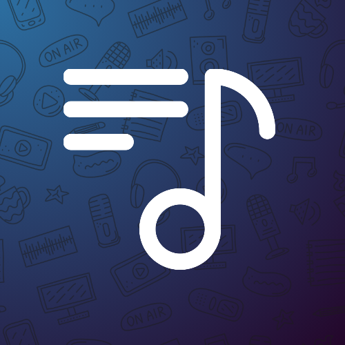
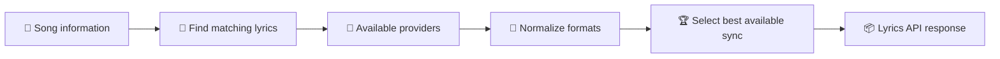

<a id="top"></a>

<div align="center">



<h1>🎧 LiriQo Lyrics API</h1>

<p><strong>One API. Eleven lyric providers. Native karaoke timing.</strong></p>
<p>Get <strong>syllable</strong>, <strong>word</strong>, <strong>character</strong>, <strong>line</strong>, or <strong>plain</strong> lyrics in a normalized format — with accurate timing and upstream attribution when available.</p>

<p>
  <a href="https://api-liriqo.web.app/"></a>
  <a href="https://api.liriqo-alfarrizi.my.id/v1"></a>
  <a href="#providers"></a>
  <a href="lyrics-parser/README.md"></a>
</p>
<p>
  <a href="https://github.com/AlFarrizi-Studio/LiriQo/releases"></a>
  <a href="https://github.com/AlFarrizi-Studio/LiriQo/stargazers"></a>
  <a href="https://github.com/AlFarrizi-Studio/LiriQo/issues"></a>
</p>

<p><strong>
  <a href="#quick-start">🚀 Quick Start</a> ·
  <a href="#providers">🎼 Providers</a> ·
  <a href="#api-reference">📡 API Reference</a> ·
  <a href="#lyrics-parser">🧩 Parser</a> ·
  <a href="#star-history">⭐ Star History</a>
</strong></p>

</div>

---

## ✨ Overview

LiriQo brings lyrics from multiple music sources together through a single, developer-friendly API. Get normalized lyrics, timestamped lines, and native karaoke timing where available — with source attribution so your application can display the right credits.

| 🎤 Karaoke-ready | 🧭 Smart selection | 🔎 Flexible search | 🧩 Easy integration |
| :--- | :--- | :--- | :--- |
| Syllable/character/word timing, synced lines, and plain text | Prefers richer synchronization when available | Video ID, song metadata, ISRC, and supported URLs | JSON responses, format exports, and a client parser |

- 🎶 **Multiple lyric formats:** Apple Music TTML, Musixmatch richsync, NetEase YRC, KuGou KRC, QQ Music QRC, Kuwo LRCX, Migu MRC, PetitLyrics WSY, plus LRC and plain text.
- 🏆 **Quality-aware results:** Native syllable/character/word timing, line-synced lyrics, and plain lyrics, with graceful fallback when a richer format is unavailable.
- 🌐 **One public API:** Use the same endpoint for search-based lyrics retrieval and normalized responses.
- 🎙️ **Rich lyric metadata:** Singer agents, background vocals, translations, romanization, and source details where provided.
- 🧩 **Client parser:** Integrate ready-to-render lyrics into JavaScript applications.

> [!NOTE]
> Format support varies by song and provider. Public API behavior may evolve with future releases; always handle missing optional fields gracefully.

## 🧭 Table of contents

| Get started | Documentation |
| :--- | :--- |
| [🚀 Quick start](#quick-start) | [📦 Response format](#response-format) |
| [🎼 Providers](#providers) | [🧩 Lyrics parser](#lyrics-parser) |
| [🏆 Sync levels](#sync-levels) | [🔄 How LiriQo works](#how-liriqo-works) |
| [📡 API reference](#api-reference) | [💡 Usage guidelines](#usage-guidelines) |
| [🎶 Lyrics inputs](#lyrics-inputs) | [🔗 Project links](#project-links) |
| [🚨 Errors & retries](#errors-and-retries) | [🙌 Credits](#credits) · [📄 License](#license) · [⭐ Star History](#star-history) |

## 🚀 Quick start

**🌐 Public API base URL:** [`https://api.liriqo-alfarrizi.my.id/v1`](https://api.liriqo-alfarrizi.my.id/v1)

> [!TIP]
> Standard public requests do not require an API key. If you receive `429`, follow the `Retry-After` header when available.

### 💻 cURL

Fetch normalized lyrics and all returned provider candidates:

```sh
curl "https://api.liriqo-alfarrizi.my.id/v1/lyrics?v=HaEYUJ2aRHs"
```

Search by title and artist, or pass explicit metadata:

```sh
curl --get "https://api.liriqo-alfarrizi.my.id/v1/lyrics" --data-urlencode "Q=Dynamite BTS"
curl --get "https://api.liriqo-alfarrizi.my.id/v1/lyrics" --data-urlencode "title=Dynamite" --data-urlencode "artist=BTS" --data-urlencode "duration=199"
```

Request a specific output format using a video ID:

```sh
curl "https://api.liriqo-alfarrizi.my.id/v1/lrc?v=HaEYUJ2aRHs"
curl "https://api.liriqo-alfarrizi.my.id/v1/plain?v=HaEYUJ2aRHs"
curl "https://api.liriqo-alfarrizi.my.id/v1/ttml?v=HaEYUJ2aRHs"
```

### 🟨 JavaScript

```js
const url = new URL('https://api.liriqo-alfarrizi.my.id/v1/lyrics');
url.searchParams.set('v', 'HaEYUJ2aRHs');

const response = await fetch(url, { signal: AbortSignal.timeout(30000) });
if (!response.ok) throw new Error(`LiriQo HTTP ${response.status}`);

const data = await response.json();
if (data.error) throw new Error(data.error);

const primary = data.primary;
for (const line of primary?.timed ?? []) {
  console.log(line.start, line.end, line.text);
  const words = line.words ?? primary.words?.[line.id] ?? [];
  for (const word of words) {
    console.log(word.start, word.end, word.text);
  }
}
```

Use embedded `timed[].words` first, with top-level `words[line.id]` as a compatibility fallback. A missing word array means that line must be rendered without word-level highlighting.

## 🎼 Providers

LiriQo integrates **11 lyric providers**. LyricFind can appear as an attributed lyric source through YouTube Music; it is **not** a separate direct provider.

| Provider | `provider` ID | Available lyric types | Notes |
| --- | --- | --- | --- |
| 🍎 **Apple Music** | `apple_music_liriqo` | `syllable`, `word`, `line`, `plain` | TTML lyrics with singer and background-vocal details where available. |
| 🎤 **Musixmatch** | `musixmatch` | `word` | Native richsync lyrics when available. Live richsync access requires authorized operator configuration and remains disabled in the current production deployment. |
| 🤝 **Unison** | `unison_community` | `syllable`, `line`, `plain` | Community-contributed TTML, LRC, or plain lyrics; availability depends on the submission. |
| ☁️ **NetEase Cloud Music** | `netease` | `word`, `line`, `plain` | Native YRC timing when available; LRC/plain alternatives. |
| 🌸 **PetitLyrics** | `petitlyrics` | `character`, `word`, `line`, `plain` | WSY/XML per-character timing decoded server-side; Japanese and Latin lyrics preserved without forcing word segmentation. |
| 🎶 **KuGou** | `kugou_legato` | `word`, `line` | KRC-based word timing and synced lyrics. |
| 🐺 **Kuwo** | `kuwo` | `character`, `word`, `line`, `plain` | LRCX decoded server-side into native per-character/word timing; CJK text and punctuation preserved; LRC/plain fallback. |
| 🎵 **Migu** | `migu` | `character`, `word`, `line`, `plain` | MRC timing decoded server-side; translation attached only when line counts match. |
| 🎧 **QQ Music** | `qq_portato` | `word`, `line` | QRC word timing; translation or romanization may be included. |
| 📚 **LRCLib** | `lrclib` | `line`, `plain` | LRC synced lyrics and plain text; no native word timing. |
| ▶️ **YouTube Music** | `ytm_line` | `line`, `plain` | Synced or plain lyrics with upstream source attribution where available. |

> [!IMPORTANT]
> **Supported formats are not guaranteed for every song.** Results depend on music catalog matching and source availability. Always check `syncLevel` and confirm that timing data is usable before enabling synchronized highlighting.

A response can contain fewer than eleven tracks, and some queries may return no usable lyric results.

## 🏆 Sync levels

LiriQo groups lyrics into three quality levels:

| Tier | `syncLevel` | Best for |
| --- | --- | --- |
| 🥇 **Jagorawi** | `syllable` or `word` | Karaoke-style word, syllable, and character highlighting |
| 🥈 **Cipali** | `line` | Highlighting the current lyric line |
| 🥉 **Bocimi** | `plain` | Lyrics display without playback synchronization |

When multiple results are available, LiriQo generally prefers more detailed synchronization while maintaining a fallback to line-based or plain lyrics. Word, syllable, and character tracks share the same top tier; the exact provider selected can depend on the song.

By default LiriQo uses **quality-aware timing**: it returns the best verified result promptly while keeping a bounded window open for higher-tier providers when only line timing is available. Two optional query parameters let you tune this behavior:

| Parameter | Effect |
| --- | --- |
| `fast=1` | Optimize for latency: return the best verified result within a short budget. May include fewer provider candidates; check the optional `partial` field. |
| `full=1` | Optimize for completeness: gather results from every eligible provider within the global deadline before responding. |

For synchronized karaoke effects, use the `/lyrics` JSON response so your app can access native word timing. The `/lrc` endpoint is intended for line-synced lyric export, while `/ttml` returns an existing TTML representation when one is available.

## 📡 API reference

**Base URL:** `https://api.liriqo-alfarrizi.my.id/v1`

The following endpoints are intended for client integrations. All paths are relative to the base URL.

| Endpoint | Response | Purpose |
| --- | --- | --- |
| `GET /lyrics` | JSON | Find lyrics and return the selected track plus other available candidates. |
| `GET /lrc` | Text | Export line-synced LRC using `v` or `videoId`. |
| `GET /plain` | JSON | Return plain lyric text using `v` or `videoId`. |
| `GET /ttml` | Text | Return an available TTML lyric document using `v` or `videoId`; `404` if unavailable. |
| `GET /search` | JSON | Find song metadata using a video ID, query, or ISRC. |
| `GET /metadata` / `GET /resolve` | JSON | Alternative metadata lookup routes. |

### 🎶 Lyrics inputs

These parameters apply to **`/lyrics`**; other endpoints can accept a smaller subset.

| Parameter | Example | Purpose |
| --- | --- | --- |
| `v` / `videoId` | `HaEYUJ2aRHs` | YouTube video ID; song information can be resolved automatically. |
| `Q` / `q` / `query` | `Dynamite BTS` | Search by song name and artist together. |
| `title` + `artist` | `Dynamite` + `BTS` | Explicit song metadata. |
| `duration` | `199` | Track duration in **seconds** to help find a matching recording. |
| `album` | `BE` | Optional album information. |
| `isrc` | `QM7282022872` | Recording identifier for additional matching. |
| `url` / `link` | YouTube or Spotify track URL | Supported music link resolution; coverage varies. |
| `fast` | `1` | Latency-first mode: return the best verified result within a bounded budget instead of waiting for every provider. |
| `full` | `1` | Completeness-first mode: wait for all eligible providers within the global deadline. |

```sh
curl --get "https://api.liriqo-alfarrizi.my.id/v1/lyrics" --data-urlencode "isrc=QM7282022872"
curl --get "https://api.liriqo-alfarrizi.my.id/v1/lyrics" --data-urlencode "url=https://open.spotify.com/track/3a1lNhkSLSkpJE4MSHpDu9"
curl --get "https://api.liriqo-alfarrizi.my.id/v1/search" --data-urlencode "Q=Dynamite BTS"
```

> [!TIP]
> Not all music-service URLs are supported. For best compatibility, provide a YouTube video ID, an ISRC, or a song-and-artist query.

### 🚨 Errors and retries

Check the HTTP status and, for JSON responses, the optional `error` field. Some lookup failures may be returned in an error object even when HTTP status is `200`.

| Status / result | Recommended client behavior |
| --- | --- |
| `400` | Check for missing or invalid inputs. |
| `403` | Request not permitted; do not repeat unchanged requests. |
| `404` | Requested resource or lyric format is unavailable. |
| `429` | Too many requests; respect `Retry-After` if supplied. |
| `503` | Temporary service unavailability; retry later with backoff. |
| `tracks: []`, `primary: null`, `count: 0` | No matching lyrics; try another query or show a graceful fallback. |

> [!WARNING]
> Avoid frequent polling or parallel duplicate requests. Use exponential backoff when retrying temporary errors.

## 📦 Response format

The `/lyrics` endpoint returns a ranked provider list and a selected `primary` track.

> [!NOTE]
> The JSON below is **illustrative**. It does not promise that this text or provider will be returned for every lookup.

```json
{
  "videoId": "HaEYUJ2aRHs",
  "metadata": {
    "title": "Dynamite",
    "artist": "BTS",
    "duration": 199,
    "isrc": "QM7282022872"
  },
  "count": 1,
  "tookMs": 1200,
  "tier": "Jagorawi",
  "mode": "full",
  "partial": false,
  "primary": {
    "provider": "netease",
    "syncLevel": "word",
    "tier": "Jagorawi"
  },
  "tracks": [
    {
      "provider": "netease",
      "upstreamProvider": "NetEase Cloud Music",
      "syncLevel": "word",
      "tier": "Jagorawi",
      "nativeWordTiming": true,
      "plain": "Hello world",
      "timed": [
        {
          "id": 0,
          "text": "Hello world",
          "start": 1000,
          "end": 3000,
          "granularity": "word",
          "words": [
            { "text": "Hello ", "start": 1000, "end": 1800 },
            { "text": "world", "start": 1900, "end": 3000 }
          ]
        }
      ]
    }
  ]
}
```

The example abbreviates `primary`; actual responses include the full selected track there. Additional optional response fields may be present. `tookMs` reports processing time and is not the complete client round-trip latency.

The optional `mode` field reports which fetching strategy produced the response (`fast`, `quality`, or `full`), and `partial` is `true` only when the result may be a subset of what a full run could find (possible with `fast=1`). Handle both fields gracefully — they are informational and may be absent in cached responses.

### ⏱️ Timing units

| Value | Unit |
| --- | --- |
| Request `duration`, numeric metadata duration | **Seconds**; some search metadata can contain an `mm:ss` string |
| `timed[].start` / `end` | **Absolute milliseconds** |
| Word `start` / `end` | **Absolute milliseconds** |
| Parsed `startTimeMs` / `durationMs` | **Milliseconds** |
| Raw Musixmatch richsync `ts`, `te`, word offset `o` | Seconds; `o` is relative to its line start |
| Raw NetEase YRC line/word timestamps | Milliseconds; word timestamps are absolute |

Keep native word ends and gaps intact. Do not multiply normalized timestamps by 1000, redistribute words evenly, or assume every line ends exactly when the next begins. Some line-only LRC routes use estimated line ends; those are not native word windows.

### 🧬 Track fields

| Field | Meaning |
| --- | --- |
| `provider` | LiriQo adapter ID from the provider table. |
| `upstreamProvider`, `lyricsSource` | Actual upstream attribution when supplied; especially important for YouTube Music. |
| `syncLevel`, `tier` | Timing granularity and quality tier. |
| `granularity` | Optional per-line timing granularity where native unit evidence exists: `character`, `word`, or `phrase` (coarse multi-token units, such as some Musixmatch richsync chunks). |
| `plain` | Plain lyric text. |
| `timed[]` | Lines with `text`, `id`, `start`, `end` and optional embedded `words`. |
| `words[]` | Optional top-level per-line word arrays, addressed by line ID. |
| `agent`, `songPart`, `isCue`, `isInstrumental` | Optional normalized line annotations; not guaranteed for every provider. Background information retained in raw TTML becomes `parts[].isBackground` in the client parser. |
| `ttml`, `lrc`, `qrc`, `krc` | Optional raw, decoded or generated representations. Some representations may be generated from normalized lyric data. |
| `nativeWordTiming`, `nativeRichsync` | Provider-specific evidence of native timing. |
| `translation`, `romanization` | Optional supplementary text; availability and alignment vary. |

Raw `yrc`/`richsync` are accepted by the client parser when provided, but a response may include only normalized `timed[].words`. Do not require raw fields for karaoke playback.

## 🧩 Lyrics parser

The [client parser documentation](lyrics-parser/README.md) covers the complete API. It supports all eleven adapter IDs and can also parse an already-fetched response offline.

```js
import { getLiriQoLyrics, ApiError } from './lyrics-parser/src/index.js';

try {
  const result = await getLiriQoLyrics('HaEYUJ2aRHs', {
    duration: 199,
    song: 'Dynamite',
    artist: 'BTS',
    timeout: 30000,
  });
  const selected = result.richsynced ?? result.synced ?? result.plain;
  for (const line of selected?.lyrics ?? []) {
    if (line.isInstrumental) continue;
    console.log(selected.source, line.startTimeMs, line.words);
    for (const part of line.parts ?? []) {
      console.log(part.startTimeMs, part.durationMs, part.words, part.isBackground);
    }
  }
} catch (error) {
  if (error instanceof ApiError) {
    console.error(error.code, error.status, error.retryAfter);
  } else {
    throw error;
  }
}
```

| Result | Content |
| --- | --- |
| `richsynced` | Native word/syllable/character `parts[]`, or `null`. |
| `synced` | Line-synced lyrics without word parts, or `null`. |
| `plain` | Unsynced text, or `null`. |
| `provider`, `syncedProvider`, `plainProvider` | Selected adapter for each result slot. |
| `route` | Parsed representation: `ttml`, `qrc`, `yrc`, `krc`, `lrcx`, `mrc`, `wsy`, `richsync`, `words`, `timed`, `lrc` or `plain`. |

The parser supports TTML, QRC, YRC, KRC, Kuwo LRCX, Migu MRC, PetitLyrics WSY, richsync, normalized word timing, LRC, and plain text. It checks for usable timing information and selects an appropriate representation for playback, labelling per-line `granularity` and derived timing honestly (for example, Musixmatch richsync unit ends are marked `derivedEnd: true`).

Pass numeric seconds to the parser's `duration` option. The parser preserves native word boundaries and supports annotations such as background vocals and singer agents when the source provides them. Translation and romanization coverage depends on each provider.

**Requirements:** Node.js 20.3+ or a compatible browser bundler. See the [parser documentation](lyrics-parser/README.md) for setup, dependencies, and examples.

## 🔄 How LiriQo works

LiriQo gives different lyric sources a consistent shape that applications can render without implementing a separate parser for every service.



Whether you're building a music player, browser extension, or companion lyrics display, the same response model supports karaoke timing, line highlighting, and unsynchronized text.

## 💡 Usage guidelines

- 🎯 **Prefer precise song metadata:** Include the song title and artist, and provide the duration or ISRC when available.
- 🕒 **Respect timestamps:** Normalized line and word times are in milliseconds; request duration is in seconds.
- 🎤 **Check the sync level:** Enable karaoke word highlighting only when native word data exists. Line-only or plain text needs a different display style.
- 🔁 **Handle unavailable results:** A missing lyric is different from an HTTP error; offer an alternate search or a plain-text fallback.
- ⏳ **Retry responsibly:** Honor `Retry-After` and use backoff for temporary errors instead of rapid repeat requests.
- 📝 **Keep attribution:** Display available source and provider information in your app when applicable.

> [!NOTE]
> Public access is designed for reasonable application use. Availability and usage limits may change over time.

## 🔗 Project links

| Resource | Link |
| --- | --- |
| 🌐 **API** | [LiriQo v1](https://api.liriqo-alfarrizi.my.id/v1) |
| 🧪 **Live demo** | [Try LiriQo](https://api-liriqo.web.app/) |
| 🧩 **Client parser** | [Parser documentation](lyrics-parser/README.md) |
| 📢 **Releases** | [GitHub Releases](https://github.com/AlFarrizi-Studio/LiriQo/releases) |
| 🐛 **Issues & feedback** | [GitHub Issues](https://github.com/AlFarrizi-Studio/LiriQo/issues) |

Contributions, bug reports, and integration feedback are welcome via GitHub Issues.

## 🙌 Credits

| Project | Contribution |
| --- | --- |
| [LDDC](https://github.com/chenmozhijin/LDDC) | Lyrics format compatibility reference (including Kuwo LRCX and Migu MRC decoding research). |
| [qrc-decoder](https://github.com/apoint123/qrc-decoder) | QRC format research reference. |
| [LRCLib](https://lrclib.net) | Open synced/plain lyrics database. |
| [Unison](https://unison.boidu.dev) | Community lyric database. |
| [Better Lyrics / @braccato](https://github.com/better-lyrics) | Lyrics parser inspiration and research. |
| [fast-xml-parser](https://github.com/NaturalIntelligence/fast-xml-parser) | XML parsing library. |

## 📄 License

The client parser package declares **MIT**. Vendored dependencies retain their respective licenses. This local snapshot does not include a root `LICENSE` file; do not treat package metadata as a replacement for the repository's license text or upstream terms.

## ⭐ Star History

Follow the repository's growth on GitHub. If LiriQo helps your project, consider leaving a ⭐!

<a href="https://www.star-history.com/?repos=alfarrizi-studio%2Fliriqo&type=date&legend=bottom-right">

 <picture>

   <source media="(prefers-color-scheme: dark)" srcset="https://api.star-history.com/chart?repos=alfarrizi-studio/liriqo&type=date&legend=bottom-right" />

   <source media="(prefers-color-scheme: light)" srcset="https://api.star-history.com/chart?repos=alfarrizi-studio/liriqo&type=date&legend=bottom-right" />

   

 </picture>

</a>

---

<div align="center">

<p><strong>Made for developers building better lyric experiences. 🎶</strong></p>
<p><a href="https://api.liriqo-alfarrizi.my.id/v1">🌐 API</a> · <a href="https://api-liriqo.web.app/">🧪 Live Demo</a> · <a href="https://github.com/AlFarrizi-Studio/LiriQo/issues">🐛 Report an issue</a> · <a href="#top">⬆️ Back to top</a></p>

</div>
